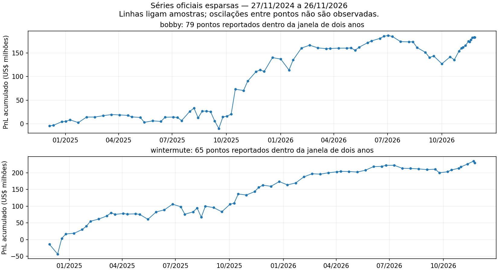
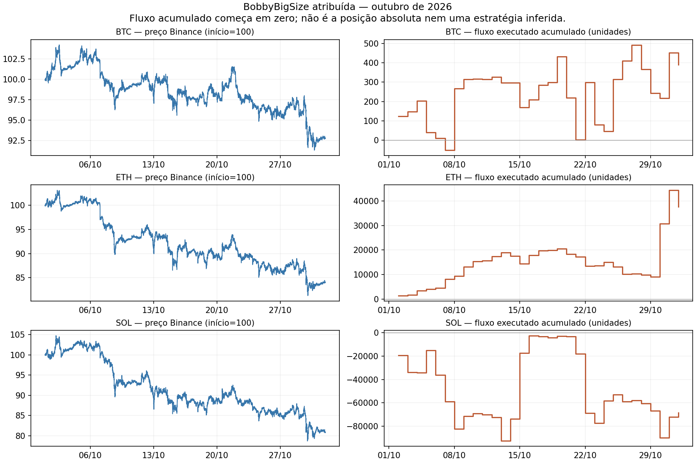

# IGOR — R17.28 parcial: comportamento de traders públicos

**Atualização de 27/11/2026: agora há coleta e análise real de dados. O estudo completo de dois anos continua bloqueado pelo limite de uma exportação por IP a cada 24 horas do portal.** Nenhuma estratégia foi promovida e o robô principal permanece intacto.

## O que foi executado

- Exportação bruta da carteira atribuída a BobbyBigSize: **1,422,691 preenchimentos**, de 01 a 31/10/2026 UTC, em 39 símbolos (38 perps e uma conversão de dust spot). Arquivo gzip de 65,208,510 bytes, SHA256 `ae9ddb381c62570c7fa0ed297feab7caff0c43eedadd9e332f84d4ba0eff6148`.
- API oficial: 1462 registros de funding e 490 eventos de ledger de outubro, além de amostras recentes de fills de BobbyBigSize e da carteira atribuída à Wintermute. Sem credenciais, chaves privadas ou envio de ordens.
- Análise por direção, ativo, taxa, frequência, fluxo executado e restrições de reconstrução de posições. Treze testes do reconstrutor passaram; somas foram conferidas por duas leituras independentes.
- O arquivo bruto foi preservado separadamente; dados da API, código, gráficos, tabelas e verificações acompanham o pacote desta etapa.

## Principal descoberta: compra não significa abertura de long

Em outubro, **79.07% do volume executado** foi rotulado como abertura ou fechamento de posições short. O PnL informado em fechamentos de shorts somou **US$ 19,862,319.93**; fechamentos de longs somaram **US$ -1,957,486.01**. As pequenas diferenças para o total incluem inversões de posição.

**Todas as execuções de BTC neste arquivo são Open Short ou Close Short.** Portanto, suas compras de BTC neste recorte são cobertura/redução de uma posição vendida, não abertura de uma posição comprada. Copiar o lado buy como sinal de alta inverteria o sentido econômico da operação. Isso decorre do campo dir do exportador; não revela o motivo da decisão nem valida o desempenho de uma réplica.

Em ETH, 87.60% do volume foi ligado a shorts; em SOL, 77.69%. BTC e ETH responderam por 74.73% da soma de PnL realizado informado. Esse é um mês específico de exposição vendida, não prova de adaptação de regime por dois anos.

## Execução: taxas e frequência fazem diferença

Há **1,393,325 fills com fee negativa (97.94%)**. No esquema oficial, taxa negativa significa rebate; a documentação também descreve os tiers de maker [HL_FILL_SCHEMA, HL_FEES]. O CSV não fornece crossed, por isso não transformamos a ausência de fee negativa em prova de execução taker.

A soma de taxas informadas foi **US$ -16,858.44**: crédito líquido de aproximadamente US$ 16,858. Isso representa só 0.094% do PnL realizado informado. **Rebates não explicam sozinhos o ganho reportado**; o viés de posição e a variação de preço têm peso material.

O intervalo mediano entre fills do mesmo ativo foi de um segundo em BTC e ETH, na resolução disponível do CSV. Houve múltiplos fills no mesmo segundo. Isso não mede latência de decisão nem tempo de posição. Milhares de execuções podem ajustar uma posição que permanece aberta por muito tempo.

As amostras recentes da API têm crossed explícito e confirmam uso predominante de execução maker nesses recortes, mas são posteriores ao mês exportado e não representam os dois anos:

| Carteira atribuída | Fills na amostra | Intervalo coberto | Maker |
|---|---:|---|---:|
| bobby | 11,955 | 26/11 23:04:31 UTC a 27/11 02:21:36 UTC | 84.39% |
| wintermute | 11,958 | 27/11 02:28:15 UTC a 27/11 03:47:01 UTC | 72.49% |

## Histórico longo obtido, em outra resolução

Também foram obtidas séries allTime pela API oficial de portfolio, abrangendo 2024–2026. Dentro da janela solicitada há 79 pontos de PnL para BobbyBigSize e 65 para Wintermute. São séries resumidas e esparsas, não o arquivo de transações. Não interpolamos meses nem as usamos para afirmar drawdown ou retorno líquido de capital.

Os pontos não coincidem necessariamente com início/fim dos meses ou com o corte de dois anos. PORTFOLIO_HISTORY.json registra datas, quantidades e hashes. Esse contexto longo foi obtido, mas não resolve quais decisões produziram a trajetória.

A coleta recente foi limitada a seis páginas por carteira. Os retornos ultrapassaram o número de 10 mil citado na documentação antiga, mas uma consulta começando em 2024 só trouxe dados recentes nesses endereços. Não há base para concluir que essa API forneça o arquivo de dois anos. Foram preservadas também respostas TWAP separadas: 2.000 slices de BobbyBigSize de 02–05/06/2026 e cinco slices da Wintermute de 30/11/2024; não são meses completos nem foram somadas ao CSV de outubro.

## Valores observados não são retorno mensal da carteira

| Campo | Valor observado |
|---|---:|
| Soma dos closedPnl preenchidos no CSV | US$ 17,908,245.69 |
| Soma das fees preenchidas no CSV | US$ -16,858.44 |
| Funding informado pela API no período | US$ 1,277,413.67 |
| Rentabilidade líquida mensal sobre capital | **Não calculada** |
| Drawdown de patrimônio e Sharpe | **Não calculados** |
| Profit factor por posições completas | **Não calculado** |

Faltam semântica validada de 162 fees vazias (notional associado de apenas US$ 62.90), 16 fechamentos com PnL vazio, patrimônio marcado no início/fim, fluxos externos classificados e conciliação de posições. Vazio não foi convertido em taxa ou PnL zero para declarar lucro integral. As somas financeiras são subtotais observados, não garantia de completude contábil.

O funding tem registros agregados com nSamples e inclui **12 ativos sem execução no CSV**, como ADA e ZRO. Isso demonstra por que o arquivo de trades sozinho não descreve todas as posições da carteira. Não usamos szi desses registros agregados como posição inicial instantânea. O ledger contém transferências internas entre dexes, transferências spot e depósitos; somar tudo como aporte externo distorceria o retorno.

## Auditoria da reconstrução de posições

**A reconstrução exata foi reprovada para este CSV.** Ele não contém startPosition, oid, tid, side explícito ou crossed e reduz o horário a segundos. O reconstrutor preservou o estado inicial como incógnita em vez de assumir posição zero.

Em leitura literal da sequência exportada, 13 ativos impõem restrições incompatíveis de posição; nenhum dos 38 perps teve posição inicial exatamente identificada. Em alguns eventos, uma abertura aparece antes da inversão para o mesmo lado dentro do mesmo segundo. Ordem intrassegundo perdida é uma possível explicação; não provamos erro da bolsa, fraude ou omissão de trades.

Não reordenamos arbitrariamente os registros para fazer a conta fechar. As métricas de posição completa, holding time, win rate e execução de uma estratégia ficaram bloqueadas. O módulo registra posições herdadas, parciais, inversões, taxas ausentes e campanhas censuradas e passou nos cenários de teste; isso não torna o estado real inferível sem os campos que faltam.

## Fluxo de execução e preço

O gráfico usa preços Binance já congelados na R17.26 e a soma assinada das quantidades do CSV. **A curva começa em zero por construção e não é o saldo absoluto da posição.** Fluxo comprador pode reduzir short; não indica necessariamente bullishness. Preços de outra venue são contexto, não preço de execução da Hyperliquid nem mark oficial. Arquivos PRICE_INPUT_HASHES.json e DAILY_MAJOR_FLOW.csv permitem verificar a figura.

## O que isso muda na pesquisa do IGOR

1. **Distinguir abrir, reforçar, reduzir, zerar e inverter.** Um imitador que usa apenas buy/sell confunde cobertura de short com entrada long. Esse erro deve ser eliminado antes de estudar indicadores.
2. **Separar direção estratégica e execução.** A evidência de outubro sugere investigar exposição majoritariamente vendida executada em muitas parcelas passivas. Não prova market making neutro, hedge externo, gatilho de entrada ou algoritmo original.
3. **Usar custos alcançáveis por nossa conta.** Não importar rebates/tiers de grandes operadores para fabricar um backtest positivo; testar ordens passivas exige livro, fila, latência e adverse selection. Tocar o preço de uma ordem não prova fill.
4. **Não promover pela realização de um mês.** Rentabilidade, patrimônio em risco, lucros não realizados e repetibilidade ainda não foram conciliados. A seleção da carteira usa informação atual, portanto o histórico é exploratório e não prova que seria possível escolhê-la no passado.
5. **Próximo requisito material:** obter arquivo de fills com milissegundos e startPosition, ou eventos de estado que resolvam as posições, e completar a janela 27/11/2024–26/11/2026 com ledger e patrimônio. Só então congelar hipóteses, validar walk-forward e paper.

## Bloqueio e escopo restante

O portal recusou a solicitação de dois anos por ultrapassar 6,25 milhões de registros. Após baixar outubro, recusou uma segunda solicitação com a mensagem: “Your IP address has reached the daily export limit (1 export per 24 hours).” Não houve tentativa de trocar IP, contornar o limite, contratar plano ou contatar terceiros.

**Um mês exportado de uma carteira não é o estudo dos dois anos de nove carteiras.** A API pública forneceu evidência complementar, sem preencher o arquivo ausente. Nenhuma análise ou coleta permanece rodando em segundo plano ao finalizar esta etapa.

## Código, dados e verificação

- inventory.py e test_inventory.py: reconstrutor com desconhecidos explícitos e treze cenários aprovados.
- analyze_export.py, behavior.py, relative_flow.py: análises executadas.
- fetch_public.py e collect_recent.py: consultas públicas executadas; nenhuma operação financeira.
- verify_research.py e VERIFICATION.json: somas, páginas e hashes conferidos; gates econômicos reprovados/pendentes.
- RAW_RECEIPT.json: origem, intervalo, tamanho e hash do arquivo bruto preservado. [Abrir arquivo bruto](https://chatgpt.com/library?file_id=libfile_f9b21a328d708191809a40d39d69b6de&account_id=personal).
- R17_28_EVIDENCE.zip: código, tabelas, gráfico, diagnósticos e respostas da API; o CSV de 65 MB é preservado separadamente e não duplicado neste pacote.
- R17.27 e versão principal preservadas; não houve mudança de estratégia de produção.

## Fontes e atribuição

Endereços e nomes continuam sendo atribuições públicas não comprovadas por nós. Métricas anteriores de terceiros serviram somente à triagem. Os achados quantitativos acima vêm do CSV efetivamente recebido e das respostas oficiais preservadas.

- [HL_API] https://hyperliquid.gitbook.io/hyperliquid-docs/for-developers/api/info-endpoint
- [HL_ARCHIVE] https://hyperliquid.gitbook.io/hyperliquid-docs/historical-data
- [EXPORT] https://trade-export.hypedexer.com/?v=1
- [COVERAGE] https://docs.hypedexer.com/guides/historical-trade-archive
- [PROVIDER] https://app.hypedexer.com/blog/hyperliquid-wallet-trade-history
- [OCTOBER] https://perpex.co/research/hyperliquid-top-traders-october-2026
- [WIN_OFFICIAL] https://www.wintermute.com/algorithmic-trading
- [WIN] https://perpex.co/copy-trading/0xecb63caa47c7c4e77f60f1ce858cf28dc2b82b00
- [WIN_EVENTS] https://blockmetric.io/wallet/0xecb63caa47c7c4e77f60f1ce858cf28dc2b82b00
- [BOBBY] https://perpex.co/copy-trading/0x7fdafde5cfb5465924316eced2d3715494c517d1
- [BOBBY_EVENTS] https://blockmetric.io/wallet/0x7fdafde5cfb5465924316eced2d3715494c517d1
- [ABRAXAS] https://blockmetric.io/wallet/0x5b5d51203a0f9079f8aeb098a6523a13f298c060
- [B83] https://blockmetric.io/wallet/0xb83de012dba672c76a7dbbbf3e459cb59d7d6e36
- [B83_LABEL] https://perpex.co/copy-trading/0xb83de012dba672c76a7dbbbf3e459cb59d7d6e36
- [LORACLE] https://perpex.co/copy-trading/0x8def9f50456c6c4e37fa5d3d57f108ed23992dae
- [LORACLE_SUB] https://perpex.co/copy-trading/0xefe4c06b6d310978bead596e1798a4fc1d9d194b
- [AGUILA] https://perpex.co/copy-trading/0x1f250df59a777d61cb8bd043c12970f3afe4f925
- [WYNN] https://blockmetric.io/wallet/0x5078c2fbea2b2ad61bc840bc023e35fce56bedb6
- [CONCENTRATED] https://perpex.co/copy-trading/0x15a4f009bb324a3fb9e36137136b201e3fe0dfdb
- [HLP] https://hyperliquid.gitbook.io/hyperliquid-docs/hypercore/vaults/protocol-vaults
- [HL_FEES] https://hyperliquid.gitbook.io/hyperliquid-docs/trading/fees
- [HL_FILL_SCHEMA] https://hyperliquid.gitbook.io/hyperliquid-docs/for-developers/api/websocket/subscriptions
- [HL_PERPETUAL_API] https://hyperliquid.gitbook.io/hyperliquid-docs/for-developers/api/info-endpoint/perpetuals
